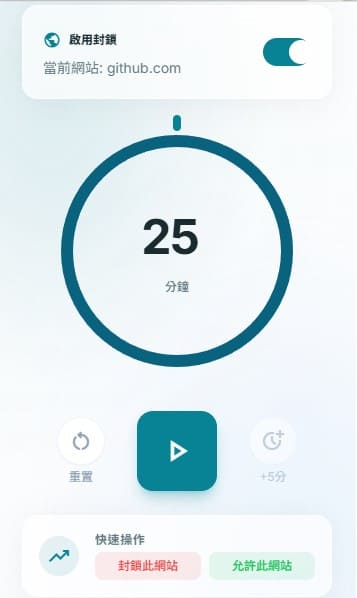

<div align="center">
  
  <h1>Limina</h1>
  <p><strong>一款設計精美、嚴格且能有效提升生產力的 Google Chrome 擴充功能。</strong></p>
  <p><i>前身為 NerdTimer。</i></p>

  <p>
    <a href="#features">功能特色</a> •
    <a href="#installation">如何安裝</a> •
    <a href="#development">開發指南</a> •
    <a href="#tech-stack">技術棧</a>
  </p>
</div>

---



## 📖 關於 Limina

Limina 是一款專為幫助您重拾專注力、停止在干擾網站上浪費時間而設計的 Chrome 擴充功能。它作為一個嚴格的生產力計時器，採用了「白名單優先」的封鎖引擎。當計時器啟動時，您可以選擇封鎖特定的干擾網站，或是僅允許工作所需的特定工具網站。

擁有現代化的玻璃擬物化 (Glassmorphism) 介面、可自訂的設定以及本地數據統計，Limina 是學生、開發者以及任何正與數位拖延症抗爭的人的完美工具。

## ✨ 功能特色

- 🛡️ **裝好就能用**：安裝時自動把 YouTube、Facebook、Instagram、X、Reddit、Threads、Dcard 加入封鎖名單，不用先設定。
- 🎯 **專注計時器**：15／25／45／60 分鐘一鍵選擇，也可自訂；可暫停、+5 分鐘，完成後會記錄專注時段。
- 🚦 **開始前選封鎖方式**：
  - **封鎖名單**：擋下封鎖名單裡的網站（預設）。
  - **僅白名單**：只有「永遠允許」名單的網站能打開，其他全部擋下。
  - **不封鎖**：計時中不擋任何網站，適合安排休息時段。
- ⏸️ **暫停封鎖**：可暫停 15 分鐘、1 小時或到明天，時間到自動恢復；暫停時工具列圖示會變灰。
- 🚧 **清楚的封鎖頁**：顯示被擋的原因、專注剩餘時間、今天已擋下幾次；可選擇「回去專注（關閉分頁）」或「休息 N 分鐘」（也可在設定中隱藏休息按鈕）。
- 📊 **統計**：專注時段、擋下次數、瀏覽時間與最常造訪網站，可切換今天／7 天／30 天（資料只存在本機，保留 90 天）。
- 🎨 **一致的介面**：依 `doc/style/style.md` 的設計規範，單一品牌色 `#009fb7`，深色模式跟隨系統設定。
- 🌍 **多語系支援**：支援英文、繁體中文與日文。
- 🔒 **隱私優先 (Privacy First)**：您所有的數據、封鎖名單與統計資料都只會使用 `chrome.storage.local` 儲存於您的設備本地端。不包含任何外部追蹤器或伺服器。

## 🚀 如何安裝

### 從原始碼安裝 (開發者模式)

1. 複製此儲存庫：
   ```bash
   git clone https://github.com/yourusername/limina.git
   ```
2. 進入 `app` 目錄並安裝依賴套件：
   ```bash
   cd limina/app
   npm install
   ```
3. 編譯擴充功能：
   ```bash
   npm run build
   ```
4. 打開 Google Chrome 並前往 `chrome://extensions/`。
5. 在右上角啟用 **開發人員模式 (Developer mode)**。
6. 點擊 **載入未封裝項目 (Load unpacked)** 並選擇位於 `limina/app` 目錄下的 `dist` 資料夾 (`limina/app/dist`)。

## 🛠️ 開發指南

Limina 使用現代網頁技術建置，前端採用 Vue 3 Composition API，背景作業則使用 Service Workers (符合 Manifest V3 規範)。

# 技術棧

- **框架**: [Vue 3](https://vuejs.org/) (Composition API)
- **打包工具**: 搭配 [`@crxjs/vite-plugin`](https://crxjs.dev/vite-plugin) 的 [Vite](https://vitejs.dev/)
- **樣式**: [Tailwind CSS](https://tailwindcss.com/)
- **狀態管理**: [Pinia](https://pinia.vuejs.org/)
- **圖示**: [Phosphor Icons](https://phosphoricons.com/)（SVG，只打包用到的圖示）
- **測試**: [Vitest](https://vitest.dev/)
- **語言**: TypeScript

## 可用腳本

在 `app` 目錄中：

- `npm run dev` - 啟動包含 HMR (熱重載) 的 Vite 開發伺服器以進行擴充功能開發。
- `npm run build` - 型別檢查後編譯打包，輸出至 `dist` 資料夾。
- `npm test` - 執行單元測試。
- `npm run logo` - 修改 logo 圖形後，重新產生 `public/icons` 下各尺寸的圖示（含暫停時的灰色版）。

## 📂 專案結構

```
limina/
├── app/
│   ├── public/             # 靜態資源 (圖示等)
│   ├── src/
│   │   ├── background/     # Service Worker (時間追蹤、快取機制、鬧鐘)
│   │   ├── content/        # Content Scripts (注入頁面的封鎖浮層)
│   │   ├── popup/          # Main Vue App (擴充功能的彈出視窗 UI)
│   │   ├── locales/        # i18n 多語系檔案 (en, zh-TW, ja)
│   │   ├── types/          # 全域 TypeScript 型別介面
│   │   ├── utils/          # 共用邏輯（封鎖規則、網域、日期）
│   │   └── composables/    # 共用的 Vue composables (例如: useI18n)
│   ├── scripts/            # 產生 logo 圖示的腳本
│   ├── manifest.json       # Chrome 擴充功能 Manifest V3
│   └── package.json
└── doc/                    # 專案文件 (PRD, 程式碼審查報告)
```

## 📝 授權條款

MIT License
